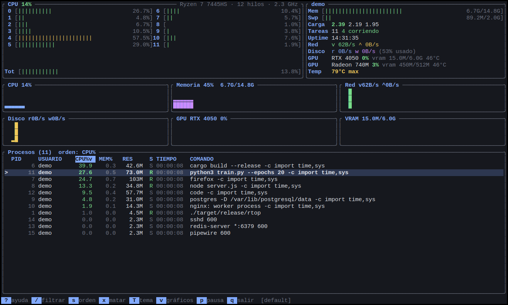
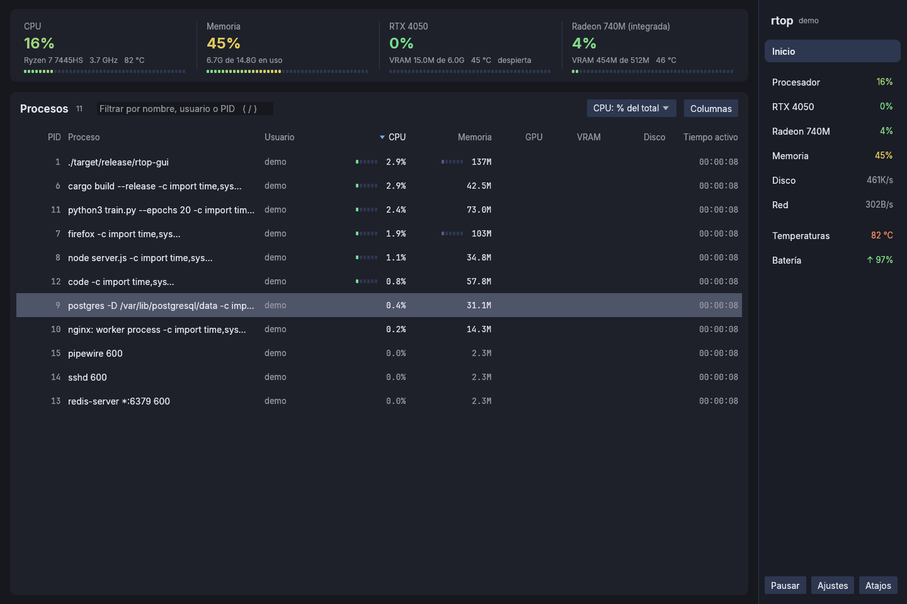
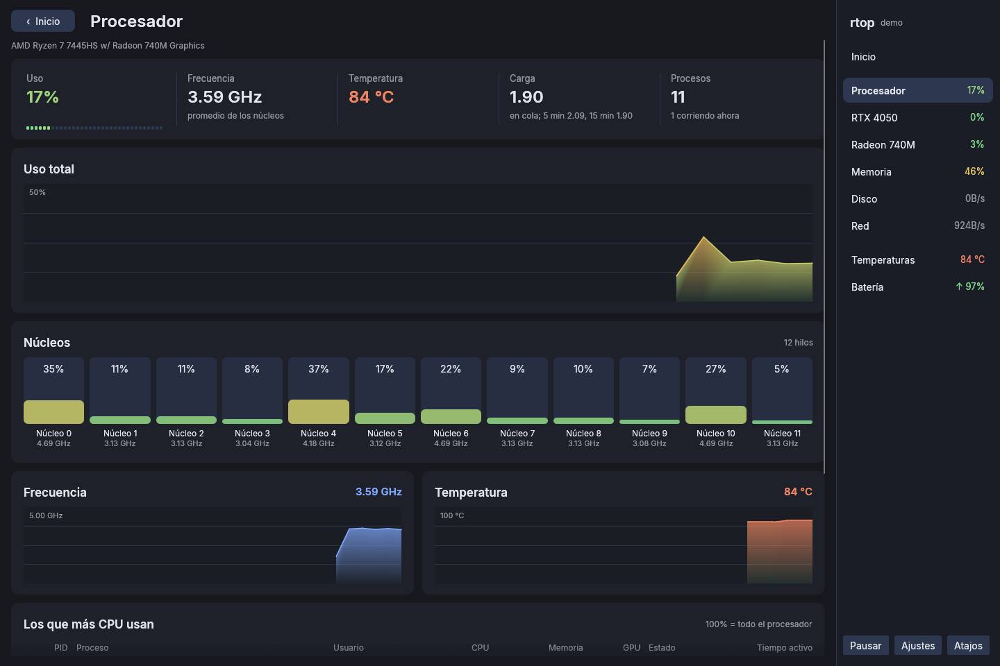
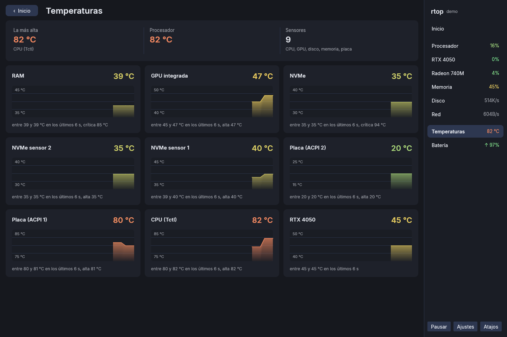

# rtop

**A system monitor for Linux, written in Rust. In the terminal or in a window, your choice.**

[](https://github.com/santiagofr1/rtop/actions/workflows/deb.yml)
[](LICENSE)
[](CONTRIBUTING.md)

rtop shows you what your machine is doing: per-core CPU, memory, GPUs (NVIDIA, AMD, and Intel), network with
per-process connections, disks, temperatures, battery, and the process list, with history and graphs. It comes in
two flavors that share the same engine:

- **`rtop`**: the TUI, for the terminal or over SSH. Fast, with htop/vim-style keys and themes.
- **`rtop-gui`**: a desktop app built with egui, with detail pages and graphs.





| CPU | Temperatures |
|---|---|
|  |  |

> The interface is currently in Spanish. An English translation is on the roadmap (see [Contributing](#contributing)).

## Features

- **CPU**: total and per-core usage, frequencies, and history.
- **Memory**: RAM and swap with a breakdown (cache, buffers, etc.).
- **GPU**: usage, VRAM, and temperature. NVIDIA via `nvidia-smi`, AMD and Intel via DRM.
- **Network**: traffic per interface and the connections each process has open.
- **Disk**: space, reads, and writes.
- **Sensors**: every temperature the system exposes, sensor by sensor.
- **Battery**: status, current power draw, and an estimate of how much each process consumes.
- **Processes**: sortable table with filtering and details. You can also kill them (SIGTERM or SIGKILL).
- **Themes**: `default`, `nord`, `gruvbox`, `dracula`, `tokyo`, and `mono`, plus custom colors.

## Installation

### Debian / Ubuntu and derivatives: apt repository (recommended)

Add the repository once, and rtop updates along with the rest of the system:

```sh
sudo install -d -m 0755 /etc/apt/keyrings
curl -fsSL https://santiagofr1.github.io/apt/key.asc | sudo gpg --dearmor -o /etc/apt/keyrings/santiagofr1.gpg
echo "deb [signed-by=/etc/apt/keyrings/santiagofr1.gpg] https://santiagofr1.github.io/apt stable main" | sudo tee /etc/apt/sources.list.d/santiagofr1.list
sudo apt update
sudo apt install rtop
```

To update: `sudo apt update && sudo apt upgrade`. The repository is GPG-signed; the code that builds it lives in
[santiagofr1/apt](https://github.com/santiagofr1/apt).

### Debian / Ubuntu: standalone .deb

Every push to `master` builds and publishes a new `.deb` in [Releases](https://github.com/santiagofr1/rtop/releases):

```sh
wget https://github.com/santiagofr1/rtop/releases/latest/download/rtop_amd64.deb
sudo apt install ./rtop_amd64.deb
```

It ships both binaries and a GUI shortcut in the applications menu.

### From source

You need stable [Rust](https://rustup.rs):

```sh
git clone https://github.com/santiagofr1/rtop
cd rtop
cargo build --release
./target/release/rtop        # TUI
./target/release/rtop-gui    # GUI
```

Building the GUI on Debian/Ubuntu may require these packages:
`libxcb-render0-dev libxcb-shape0-dev libxcb-xfixes0-dev libxkbcommon-dev libgl1-mesa-dev`.

## Usage

```sh
rtop          # in the terminal
rtop --gui    # open the window (same as rtop-gui)
```

TUI keys:

| Key | Action |
|---|---|
| `↑↓` / `j k`, `PgUp PgDn`, `g G` | Move |
| `/` or `F3` | Filter processes |
| `c m n i t` | Sort by CPU, memory, name, PID, or time |
| `s` / `Tab` / `F6` | Change sort column · `r` to reverse it |
| `x` / `F9` / `Del` | Kill the process (`9` for SIGKILL) |
| `p` / `Space` | Pause |
| `l` | Show the full command line |
| `v` | Show or hide graphs |
| `T` | Switch theme |
| `+ -` | Adjust the refresh rate |
| `?` / `F1` | Help |
| `q` / `F10` | Quit |

## Configuration

`~/.config/rtop/config.toml` is shared by the TUI and the GUI. Changes you make from the app are saved
automatically.

```toml
theme = "nord"          # default | nord | gruvbox | dracula | tokyo | mono
refresh_ms = 1000
show_graphs = true
show_cmd = false

[colors]                # optional: override colors of the selected theme
accent = "#ff8800"
```

## Architecture

```
crates/
├── rtop-core   # the engine: collects and parses system data (no UI, with tests)
├── rtop        # TUI with ratatui
└── rtop-gui    # GUI with egui/eframe
```

Everything read from the system lives in `rtop-core`. To add a new metric, start there and both interfaces can
use it.

## Contributing

rtop is **free software** under the MIT license. You can use, copy, modify, and redistribute it however you like,
including in commercial projects.

Free software works because people dive in. You don't need to be a Rust expert or ask for permission:

- **Fork it** and make your own version: a different layout, another palette, the metrics you care about. If it
  turns out nice, share it.
- **Send a PR**, however small. Fixing a typo, adding a color theme, or improving a parser all count.
- **Open an issue** if something doesn't work on your hardware. With so many different GPUs, sensors, and
  batteries out there, your report is what makes it work for everyone.
- **Suggest ideas**: support for other distros, Arch/Fedora packaging, Flatpak, new pages, data export…

Some good first contributions:

- [ ] New color themes (`crates/rtop-core/src/config.rs`)
- [ ] A proper app icon
- [ ] Packages for other distros (AUR, RPM, Flatpak)
- [ ] More tests for the `rtop-core` parsers
- [ ] English translation of the interface

See [CONTRIBUTING.md](CONTRIBUTING.md) to get started.

## License

[MIT](LICENSE). Do whatever you want with the code, just keep the copyright notice.
